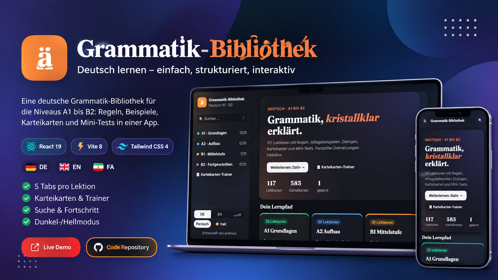

<div align="center">

# 📚 Grammatik-Bibliothek



**A German grammar library for levels A1 to B2: rules, examples, flashcards and mini-tests in one calm, fast web app.**


### 🌐 [Live demo](https://german-grammar-library.vercel.app/)

</div>

---

## What it is

Grammatik-Bibliothek turns a folder of Markdown study notes into a browsable learning app. Every lesson is split into five tabs, so you can read the idea, check the rules, study examples, practise, and review without scrolling through one long page.

The app is a static site. There is no backend, no account and no database.

👉 **Try it live:** [Grammatik-Bibliothek · Deutsch A1–B2](https://german-grammar-library.vercel.app/), hosted on [Vercel](https://vercel.com).

## What is inside

|                         |                                         |
| ----------------------- | --------------------------------------- |
| **Lessons**             | 117 (A1: 25 · A2: 30 · B1: 31 · B2: 31) |
| **Sections per lesson** | 19                                      |
| **Flashcards**          | 585                                     |
| **Example sentences**   | 2,107 (German with Persian translation) |

The numbers above are counted from the notes in `content/` by `scripts/build-content.mjs`.

## Features

- **Five tabs per lesson:** Overview, Rules, Examples, Practice, Remember.
- **Examples with translations:** each German sentence is shown with its Persian translation, and a 🔊 button reads the German aloud using your browser's speech voices.
- **Flashcards:** flip cards for every lesson, plus a trainer that deals 25 random cards from all levels. Keyboard: `Space` flips, `←` `→` browse.
- **Search:** press `/` or `Ctrl/⌘ + K` to search titles, tags and the full text of every lesson.
- **Progress:** mark lessons as learned. Progress, theme and language are stored in your browser's `localStorage`.
- **Light and dark theme:** follows your system setting until you choose one.
- **Three interface languages:** Deutsch, English and فارسی. Persian switches the whole layout to right-to-left.
- **Persian typography:** Vazirmatn for the interface and Noto Naskh Arabic for example translations.
- **Responsive:** sidebar on desktop, slide-out menu on phones.
- **Reduced motion:** animations are switched off when your system asks for it.

## Quick start

You need [Node.js](https://nodejs.org) 20.19 or newer (or 22.12 or newer), as required by Vite 8.

```bash
npm install
npm run dev        # development server (http://localhost:5173)
npm run build      # production build in dist/
npm run preview    # serve the production build locally
```

## Deploy

`npm run build` produces a static site in `dist/`. It uses hash links (`#a1-01`) and relative asset paths, so it needs no rewrite rules and also works from a sub-folder.

| Host                              | Settings                                               |
| --------------------------------- | ------------------------------------------------------ |
| Netlify, Vercel, Cloudflare Pages | Build command `npm run build`, output directory `dist` |
| GitHub Pages or any static host   | Upload the contents of `dist/`                         |

## Editing the lessons

The notes live in `content/German-Grammar-Library/`, one folder per level. After you change a note, regenerate the data file:

```bash
npm run content    # writes src/data/lessons.json
```

`src/data/lessons.json` is committed, so `npm run dev` and `npm run build` work without running this step first.

Each note is a Markdown file with frontmatter (`title`, `level`, tags) and `##` sections. The script reads these sections:

| Tab      | Sections                                                                                         |
| -------- | ------------------------------------------------------------------------------------------------ |
| Overview | Idea in 10 seconds, Golden formula, Mini rule card, Visual memory aid, Teacher's memory sentence |
| Rules    | Key rules, Extra overviews, Don't mix these up, Typical mistakes, Sentence lab                   |
| Examples | Examples, Everyday examples, Mini dialogue                                                       |
| Practice | Mini test, Speaking, Writing, Flashcards                                                         |
| Remember | 30-second review, Spaced repetition plan                                                         |

Example lines are expected as a 🇩🇪 line followed by a 🇮🇷 line. Flashcards are expected as `**Frage:**` / `**Antwort:**` pairs.

## Project structure

```
content/German-Grammar-Library/   lesson notes (Markdown)
scripts/build-content.mjs         notes → src/data/lessons.json
src/
  App.jsx                         layout, hash routing, theme, language, progress
  i18n.js                         Deutsch / English / فارسی interface texts
  index.css                       Tailwind import and @theme, design tokens, Markdown styles
  lib/                            data, author credits, localStorage wrapper, Markdown, speech, hash hook
  components/                     Sidebar, Home, Level, Lesson, Section, Cards, Trainer, Search, Footer
vite.config.js                    React + Tailwind plugins, relative base path, chunk splitting
```

## Tech

- [React 19](https://react.dev), [Vite 8](https://vite.dev), [Tailwind CSS 4](https://tailwindcss.com) (via the `@tailwindcss/vite` plugin)
- [marked](https://marked.js.org) renders the Markdown in each section
- [Fontsource](https://fontsource.org) packages serve Inter, Fraunces, Vazirmatn and Noto Naskh Arabic from your own site, so the app makes no requests to Google Fonts

## Made with AI

- **App:** this web app was built with the help of [Claude](https://claude.ai), an AI assistant made by Anthropic.
- **Lesson content:** the Markdown notes in `content/` were generated with [DeepSeek](https://www.deepseek.com), an AI model.

AI-generated text can contain mistakes. Check the grammar rules, example sentences and Persian translations against a trusted source before relying on them.

## Good to know

- **Only the interface is translated.** Lesson explanations stay in German, with Persian translations where the notes contain them. There is no English lesson text.
- **Speech quality depends on your device.** The 🔊 button uses the browser's built-in German voice, and some browsers have none.
- **Mini-tests are not interactive.** They appear as written in the notes, with the answers behind an expandable "show answers" element.
- **The lesson data is large.** `lessons.json` is about 1 MB (about 236 KB compressed) and is loaded in its own file, so it is cached separately from the app code.
- **Tested lightly.** The production build succeeds and a simulated-browser check of the main screens passed. The project ships no automated tests and has not been checked on every browser or device.
- **Persian inside tables** stays visible when you hide the Persian translations, because only the example sentences are hidden.

## Author

Made by **arwinux**

- GitHub: [github.com/arwinux](https://github.com/arwinux)
- LinkedIn: [linkedin.com/in/arwinux](https://www.linkedin.com/in/arwinux)
- Telegram channel: [@arwinuxrepo](https://t.me/arwinuxrepo)
- LeetCode: [leetcode.com/u/arwinux](https://leetcode.com/u/arwinux/)

## License

Released under the [MIT License](LICENSE).
